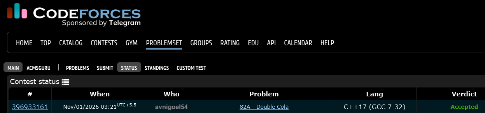

# Codeforces 82 A. **Double Cola**

## **Approach** - 
    -Each name appears p times, with p doubling after every round.
    -Subtract complete rounds (5*p) until n falls within the current round.
    -Use (n-1)/p to find and print the corresponding name.

## **Code** -
    
```cpp

#include <bits/stdc++.h>
using namespace std;

  int main() {
      long long n;
      cin >> n;
      vector<string> names = {"Sheldon", "Leonard", "Penny", "Rajesh", "Howard"};
      long long p = 1;
      while (n > 5 * p) {
          n -= 5 * p;
          p *= 2;
      }
      cout << names[(n - 1) / p];
  }
```


