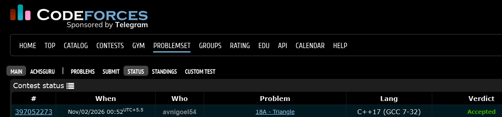

# Codeforces 18 A. **Triangle**

## **Approach** - 
    -Calculate all three squared side lengths, sort them, and check the Pythagorean condition to detect a right triangle.
    -If not RIGHT, move each vertex one unit in the four possible directions and recheck.
    -Print ALMOST if any modification forms a right triangle; otherwise, print NEITHER.

## **Code** -
    
```cpp

#include <bits/stdc++.h>
using namespace std;

  bool right(int x1,int y1,int x2,int y2,int x3,int y3) {
      int a = (x1-x2)*(x1-x2)+(y1-y2)*(y1-y2);
      int b = (x2-x3)*(x2-x3)+(y2-y3)*(y2-y3);
      int c = (x3-x1)*(x3-x1)+(y3-y1)*(y3-y1);
      vector<int> v = {a,b,c};
      sort(v.begin(),v.end());
      return v[0] > 0 && v[0]+v[1]==v[2];
  }
  
  int main() {
      int x1,y1,x2,y2,x3,y3;
      cin >> x1 >> y1 >> x2 >> y2 >> x3 >> y3;
      if(right(x1,y1,x2,y2,x3,y3)) { cout << "RIGHT"; return 0; }
  
      int x[] = {x1,x2,x3};
      int y[] = {y1,y2,y3};
  
      for(int i=0;i<3;i++) {
          for(int dx=-1;dx<=1;dx++) {
              for(int dy=-1;dy<=1;dy++) {
                  if(abs(dx)+abs(dy)!=1) continue;
  
                  int a=x[0],b=y[0],c=x[1],d=y[1],e=x[2],f=y[2];
  
                  if(i==0) a+=dx,b+=dy;
                  if(i==1) c+=dx,d+=dy;
                  if(i==2) e+=dx,f+=dy;
  
                  if(right(a,b,c,d,e,f)) { cout << "ALMOST"; return 0; }
              }
          }
      }
      cout << "NEITHER";
  }
```


