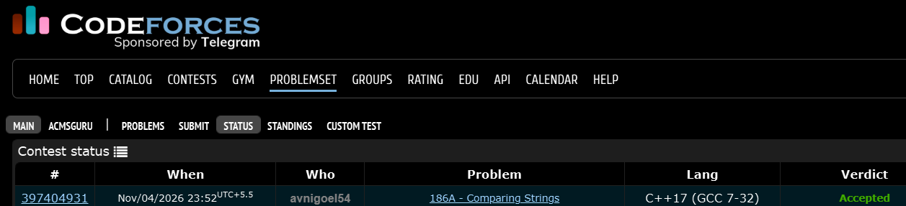

# Codeforces 186 A. **Comparing Strings**

## **Approach** - 
    -Check if both strings have equal lengths and exactly two mismatched positions.
    -Find the indices of the two mismatches.
    -Check if swapping those characters makes both strings identical; print YES or NO.

## **Code** -
    
```cpp

#include <bits/stdc++.h>
using namespace std;

  int main() {
      string s1,s2; cin>>s1>>s2;
      if(s1.size()!=s2.size()){
          cout<<"NO"; return 0;
      }
      vector<int> a(s1.size(),-1);
      int cnt=0;
      for(int i=0;i<s1.size();i++){
          if(s1[i]==s2[i])a[i]=0;
          else cnt++;
      }
      if(cnt!=2) {
          cout<<"NO"; return 0;
      }
      int p=s1.size(),q=-1;
      for(int i=0;i<s1.size();i++){
          if(a[i]==-1){
              p=min(p,i);
              q=max(q,i);
          }
      }
      if(s1[p]==s2[q] && s1[q]==s2[p]) cout<<"YES";
      else cout<<"NO";
  }

```


