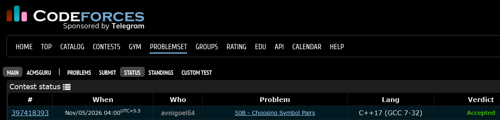

# Codeforces 50 B. **Choosing Symbol Pairs**

## **Approach** - 
    -Count the frequency of each character using a map.
    -Calculate the sum of squares of all character frequencies.
    -Print the sum as the total number of valid ordered pairs

## **Code** -
    
```cpp

#include <bits/stdc++.h>
using namespace std;

  int main() {
      string s; cin>>s;
      map<char,long long> mp;
      for(char c:s) mp[c]++;
      long long sm=0;
      for(auto i : mp) sm+= i.second * i.second;
      cout<<sm;
  }

```


