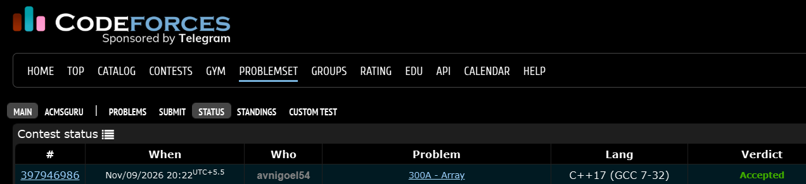

# Codeforces 300 A. **Array**

## **Approach** - 
    -Separate the numbers into three groups: negative, positive, and zero.
    -Ensure the first group has an odd number of negative elements, and the second group has a positive product (one positive or two negatives).
    -Place all remaining elements, including zeros, in the third group.

## **Code** -
    
```cpp

#include <bits/stdc++.h>
using namespace std;

  int main() {
      int t; cin>>t;
      vector<int> st1;
      vector<int> st2;
      vector<int> st3;
      vector<int> a(t);
      for(int i=0;i<t;i++){
          cin>>a[i];
      }
      int neg=0,pos=0;
      for(int i=0;i<t;i++){
          if(!a[i]) st3.push_back(a[i]);
          if(a[i]<0) neg++;
          else if(a[i]>0) pos++;
      }
      int k=-1;
      if(!pos){
          int cnt=0;
          for(int i=0;i<t;i++){
              if(a[i]<0 && cnt<2){
                  cnt++;
                  st2.push_back(a[i]);
                  k=i;
              }
          }
          neg-=2;
      }
      if(neg % 2){
          for(int i=k+1;i<t;i++){
              if(a[i]<0) st1.push_back(a[i]);
          }
      }
      else{
          int i=k+1;
          while(i<t && neg!=1){
              if(a[i]<0) {st1.push_back(a[i]); neg--;}
              i++;
          }
          while(i<t){
              if(a[i]<0) st3.push_back(a[i]);
              i++;
          }
      }
      for(int i=0;i<t;i++){
          if(a[i]>0) st2.push_back(a[i]);
      }
      cout<<st1.size();
      for(int i:st1) cout<<" "<<i;
      cout<<endl;
      
      cout<<st2.size();
      for(int i:st2) cout<<" "<<i;
      cout<<endl;
      
      cout<<st3.size();
      for(int i:st3) cout<<" "<<i;
      cout<<endl;
  }

```


