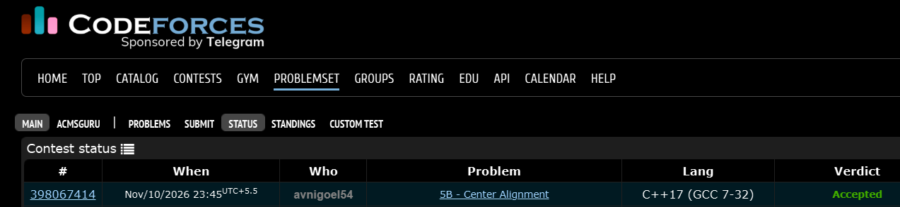

# Codeforces 5 B. **Center Alignment**

## **Approach** - 
    -Read all input lines and find the maximum line length (mx).
    -Center-align each line by distributing extra spaces equally on both sides.
    -Alternate the extra space between left and right when the padding is odd, then surround everything with * borders.

## **Code** -
    
```cpp

#include <bits/stdc++.h>
using namespace std;

  int main() {
      string s;
      vector<string> a;
      int mx=0;
      while(getline(cin,s)){
          a.push_back(s);
          mx=max(mx,int(s.size()));
      }
      for (int i=0; i <mx+2; i++) cout << "*";
      cout << endl;
      bool leftt = true;
      for(string str:a){
          int space = mx - str.size();
          int left=space/2, right = space/2;
          if(space%2){
              if(leftt) {
                  right++; leftt=false;
              }
              else{
                  left++; leftt=true;
              }
          }
          cout << "*" << string(left, ' ') << str << string(right, ' ') << "*\n";
      }
      for (int i=0; i <mx+2; i++) cout << "*";
  }

```


