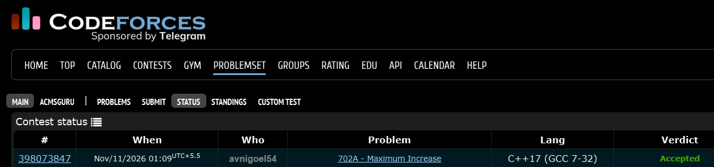

# Codeforces 702 A. **Maximum Increase**

## **Approach** - 
    -Traverse the array and track the current length of the strictly increasing contiguous segment.
    -Reset the count whenever the next element is not greater than the previous one.
    -Maintain and print the maximum segment length.

## **Code** -
    
```cpp

#include <bits/stdc++.h>
using namespace std;

  int main() {
      int n; cin>>n;
      vector<int> a(n);
      int curr=1,mx=1;
      for(int i=0;i<n;i++){
          cin>>a[i];
          if(i && a[i]<=a[i-1]){
              mx=max(mx,curr);
              curr=0;
          }
          if(i)curr++;
      }
      mx=max(mx,curr);
      cout<<mx;
  }
```


