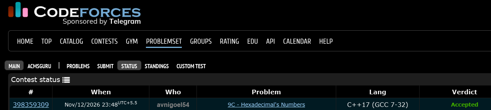

# Codeforces 9 C. **Hexadecimal's Numbers**

## **Approach** - 
    -Generate all 10-bit binary strings except 0000000000 and convert them to numbers.
    -Count how many generated numbers contain only 0s and 1s and are less than or equal to n.
    -Print the total count.

## **Code** -
    
```cpp

#include <bits/stdc++.h>
using namespace std;

  int main() {
      long long n;
      cin >> n;
  
      int ans = 0;
  
      for (int i = 1; i < (1 << 10); i++) {
          string s = "";
  
          for (int j = 9; j >= 0; j--) {
              if (i & (1 << j))
                  s += '1';
              else
                  s += '0';
          }
  
          long long num = stoll(s);
  
          if (num <= n)
              ans++;
      }
  
      cout << ans;
      return 0;
  }
```


