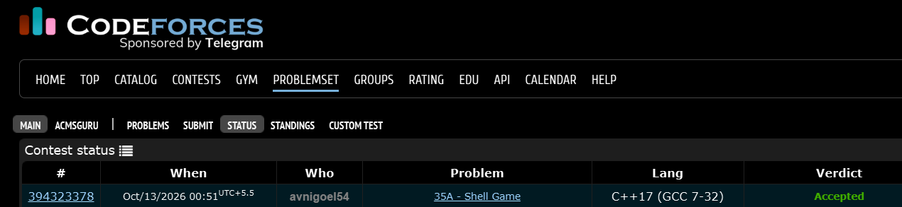

# Codeforces 35 A. **Shell Game**

## **Approach** - 
    -Read the initial number and three swap pairs from input files
    -Track the number’s position after each swap
    -Output the final position to output.txt

## **Code** -
    
```cpp
#include <bits/stdc++.h>
using namespace std;

  int main() {
      freopen("input.txt", "r", stdin);
      freopen("output.txt", "w", stdout);

      int n; cin>>n;
      for(int i=0;i<3;i++){
          int c,d; cin>>c>>d;
          if(c==n) n=d;
          else if(d==n) n=c;
      }
      cout<<n;
  }

```


