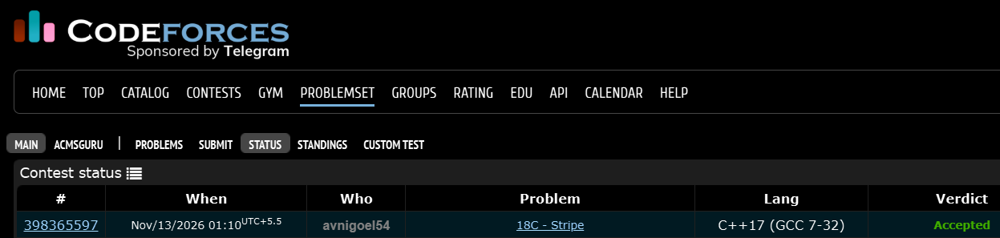

# Codeforces 18 C. **Stripe**

## **Approach** - 
    -Calculate the total sum and initialize left and right partition sums.
    -Traverse the array, moving one element at a time from the right sum to the left sum.
    -Count positions where both sums are equal and print the total.

## **Code** -
    
```cpp

#include <bits/stdc++.h>
using namespace std;

  int main() {
      int n; cin>>n;
      if(n == 1) {cout << 0; return 0;}
      vector<int> a(n);
      int sm=0;
      for(int i=0;i<n;i++){ cin>>a[i]; sm+=a[i];}
      int s_left=a[0],s_right = sm-s_left,cnt=0;
      int i=0,j=1;
      while(j<n-1){
          if(s_left==s_right) cnt++;
          i++; j++;
          s_left+=a[i];
          s_right-=a[i];
      }
      if(s_left==s_right) cnt++;
      cout<<cnt;
  }

```


