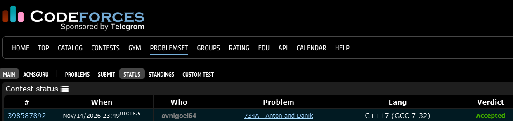

# Codeforces 734 A. **Anton and Danik**

## **Approach** - 
    -Count the number of wins by Anton (A).
    -Compare Anton's wins with Danik's wins (n - cnt).
    -Print the winner's name or Friendship if both have equal wins.

## **Code** -
    
```cpp

#include <bits/stdc++.h>
using namespace std;

int main() {
    int n; cin>>n;
    string s; cin>>s;
    int cnt=0;
    for(char c:s) if(c=='A')cnt++;
    if(cnt>n-cnt) cout<<"Anton";
    else if(cnt<n-cnt)cout<<"Danik";
    else cout<<"Friendship";

}

```


