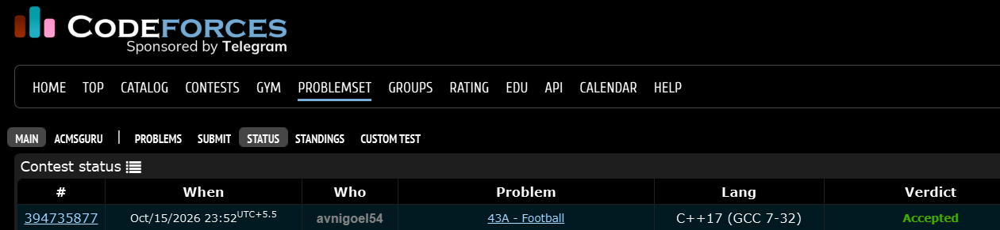

# Codeforces 43 A. **Football**

## **Approach** - 
    -Apply Moore’s Voting Algorithm to find the majority team
    -Maintain a candidate team ele and update its vote count cnt
    -Increment for a match, decrement otherwise; output ele

## **Code** -
    
```cpp
#include <bits/stdc++.h>
using namespace std;

  int main() {
      int n; cin >> n;
      string s, ele;
      int cnt = 0;
      for (int i = 0; i < n; i++) {
          cin >> s;
          if (cnt == 0) ele = s;
          if (s == ele) cnt++;
          else cnt--;
      }
      cout << ele;
  }

```


