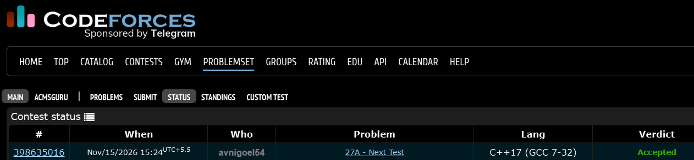

# Codeforces 27 A. **Next Test**

## **Approach** - 
    -Sort the array in ascending order.
    -Traverse positive integers starting from 1, skipping elements smaller than the current number.
    -Print the first positive integer missing from the array.

## **Code** -
    
```cpp

#include <bits/stdc++.h>
using namespace std;

  int main() {
      int n; cin>>n;
      vector<int> a(n);
      for(int i=0;i<n;i++){
          cin>>a[i];
      }
      sort(a.begin(),a.end());
      int j=0;
      for(int i=1;i<=3001;i++){
          while(j<n && a[j]<i) j++;
          if(j==n or a[j]!=i){
              cout<<i; break;
          }
      }
  }

```


