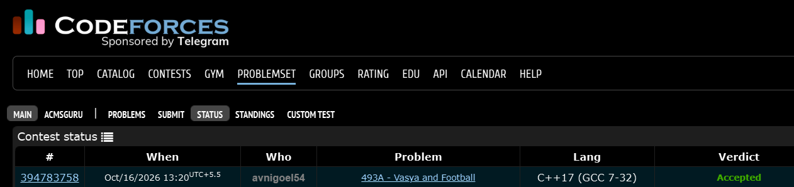

# Codeforces 493 A. **Vasya and Football**

## **Approach** - 
    -Track each player’s card status by team and jersey number
    -Update yellow/red card states; skip players already sent off
    -Print the team name, player number, and minute when a player receives a red card or a second yellow card

## **Code** -
    
```cpp
#include <bits/stdc++.h>
using namespace std;

  int main() {
      string h_team_name, a_team_name;
      cin >> h_team_name >> a_team_name;
      int n; cin >> n;
  
      vector<pair<int, char>> hteam(100), ateam(100);
      
      while (n--) {
          int min, num;
          char team, card;
          cin >> min >> team >> num >> card;
          
          if (team == 'h') {
              hteam[num].first = min;
              char color = hteam[num].second;
              if (color == 'r') continue;
              
              hteam[num].second = (hteam[num].second == 'y'
                  or hteam[num].second == 'r'
                  or card == 'r') ? 'r' : 'y';
              if (color == 'y' or card == 'r') 
                  cout << h_team_name << " " << num << " " << min << endl;
          }
          else {
              ateam[num].first = min;
              char color = ateam[num].second;
              if (color == 'r') continue;
              
              ateam[num].second = (ateam[num].second == 'y'
                  or ateam[num].second == 'r'
                  or card == 'r') ? 'r' : 'y';
              if (color == 'y' or card == 'r') 
                  cout << a_team_name << " " << num << " " << min << endl;
          }
      }
  }
```


