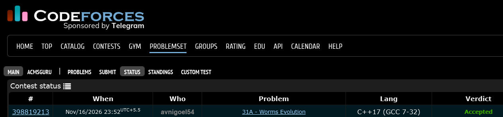

# Codeforces 31 A. **Worms Evolution**

## **Approach** - 
    -Store each array element's indices in a map to find elements by value.
    -Check every pair (i, j) and search for a third element equal to their sum.
    -Ensure all three indices are distinct; print their 1-based indices or -1 if no valid triplet exists.

## **Code** -
    
```cpp

#include <bits/stdc++.h>
using namespace std;

  int main() {
      int n; cin >> n;
      vector<int> a(n);
      map<int, vector<int>> mp;
  
      for(int i=0;i<n;i++){
          cin >> a[i];
          mp[a[i]].push_back(i);
      }
  
      for(int i=0;i<n;i++){
          for(int j=i+1;j<n;j++){
              int sum = a[i]+a[j];
  
              for(int k : mp[sum]){
                  if(k!=i && k!=j){
                      cout << k+1 << " " << i+1 << " " << j+1;
                      return 0;
                  }
              }
          }
      }
  
      cout << -1;
  }

```


