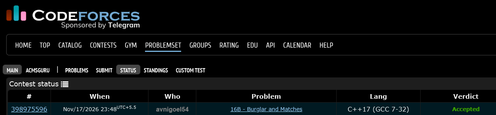

# Codeforces 16 B. **Burglar and Matches**

## **Approach** - 
    -Sort matches in descending order of matchbox price per box.
    -Greedily take as many boxes as possible from the highest-priced matchbox type.
    -If the remaining capacity is smaller, take only the required boxes and calculate the maximum total value

## **Code** -
    
```cpp

#include <bits/stdc++.h>
using namespace std;

  int main() {
      int n,m; cin>>n>>m;
      vector<pair<int,int>> v(m);
  
      for(int i=0;i<m;i++){
          cin>>v[i].first>>v[i].second;
      }
  
      sort(v.begin(),v.end(),[](auto x, auto y) { return x.second > y.second; });
  
      int i=0,cnt=0;
      while(n>0 && i<m){
          if(v[i].first <= n){
              n-=v[i].first;
              cnt += v[i].second * v[i].first;
              i++;
          }
          else{
              cnt += v[i].second * n;
              n=0;
          }
      }
      cout<<cnt;
  }

```


