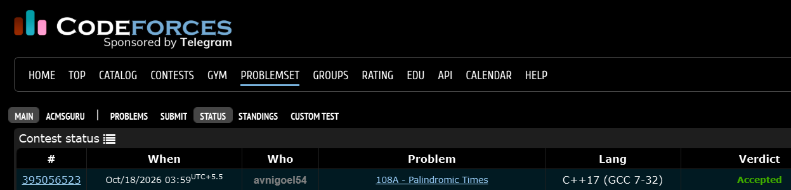

# Codeforces 108 A. **Palindromic Times**

## **Approach** - 
    -Iterate through all valid hours from 00 to 23.
    -Reverse each hour to generate the corresponding minutes.
    -Skip if the minutes are 60 or greater.
    -Form the time in HH:MM format and find the first time lexicographically greater than the given time.
    -If no such time exists, print 00:00.

## **Code** -
    
```cpp

#include <bits/stdc++.h>
using namespace std;

  int main() {
      string s;
      cin >> s;
      
      bool abc=false;
      for(int i = 0; i < 24; i++) {
          string hour = (i<10 ? "0" : "") + to_string(i);
          string rev=hour;
          reverse(rev.begin(), rev.end());
          if(rev>="60")continue;
          string ans=hour+":"+rev;
          if(ans>s){
              cout<<ans; abc=true; break;
          }
      }
      if(!abc) cout<<"00:00";
  }

```


