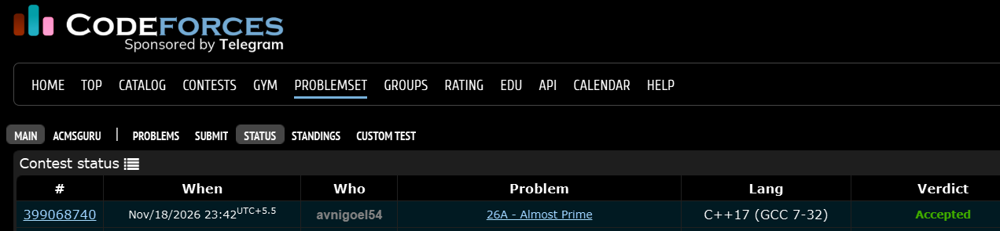

# Codeforces 26 A. **Almost Prime**

## **Approach** - 
    -Iterate through all numbers from 1 to n and count their distinct prime factors.
    -Use repeated division to remove all occurrences of each prime factor.
    -Increment ans if a number has exactly two distinct prime factors, then print the total.

## **Code** -
    
```cpp

#include <bits/stdc++.h>
using namespace std;

  int main() {
      int n; cin >> n;
      int ans = 0;
      for(int i = 1; i <= n; i++) {
          int x = i, cnt = 0;
          for(int j = 2; j <= x; j++) {
              if(x % j == 0) {
                  cnt++;
                  while(x % j == 0) x /= j;
              }
          }
          if(cnt == 2) ans++;
      }
      cout << ans;
  }

```


