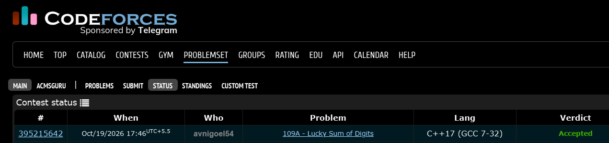

# Codeforces 109 A. **Lucky Sum of Digits**

## **Approach** - 
    -Iterate over the number of 7s from maximum to 0.
    -Calculate the remaining sum after using 7s.
    -If the remainder is divisible by 4, print the required 4s followed by 7s and exit.
    -If no valid combination exists, print -1.

## **Code** -
    
```cpp

#include <bits/stdc++.h>
using namespace std;

int main() {
	int y; cin>>y;
	for(int t=y/7;t>=0;t--){
	    int rem = y - t*7;
	    if(!(rem%4)){
	        for(int i=0;i<rem/4;i++) cout<<4;
    	    for(int i=0;i<t;i++) cout<<7;
    	    return 0;
	    }
	}
	cout<<-1;
}

```


