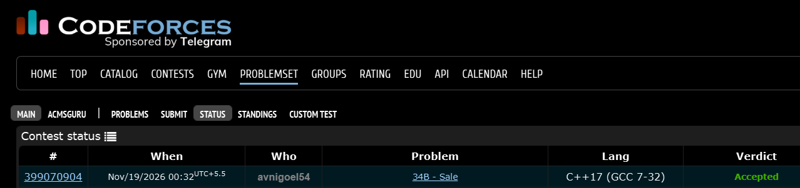

# Codeforces 34 B. **Sale**

## **Approach** - 
    -Read and sort the TV prices in ascending order.
    -Pick up to m TVs with negative prices (owners pay you to take them).
    -Add their prices and print the absolute value of the sum to maximize profit.

## **Code** -
    
```cpp

#include <bits/stdc++.h>
using namespace std;

  int main() {
      int n,m;
      cin >> n>>m;
  
      int ans = 0;
      vector<int> a(n);
      for(int i = 1; i <= n; i++){
          cin>>a[i-1];
      }
      sort(a.begin(),a.end());
      for(int i=0;i<m;i++){
          if(a[i]<0) ans+=a[i];
      }
      cout << - ans;
  }

```


