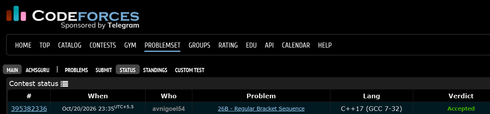

# Codeforces 26 B. **Regular Bracket Sequence**

## **Approach** - 
    -Push ( onto a stack; pop when a matching ) is found.
    -Count unmatched closing brackets in cnt.
    -Subtract unmatched brackets from the string length to get the longest regular bracket subsequence.

## **Code** -
    
```cpp

#include <bits/stdc++.h>
using namespace std;

  int main() {
  	string s; cin>>s;
  	stack<char> st;
  	int cnt=0;
  	for(char c:s){
  	    if(c=='(') st.push(c);
  	    else if(!st.empty()) st.pop();
  	    else cnt++;
  	}
  	cout<<s.size() - cnt - st.size();
  }

```


