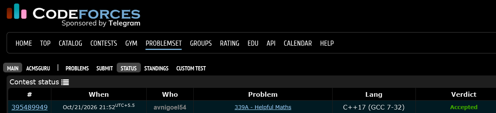

# Codeforces 339 A. **Helpful Maths**

## **Approach** - 
    -Count occurrences of 1, 2, and 3 in the string.
    -Rebuild the sum in sorted order (1+2+3), repeating each digit by its frequency.
    -Remove the trailing + and print the result.

## **Code** -
    
```cpp

#include <bits/stdc++.h>
using namespace std;
  
  int main() {
  	string s; 
  	cin>>s;
  	int cnt_1=0,cnt_2=0,cnt_3=0;
  	for(char c:s){
  	    if(c=='1') cnt_1++;
  	    if(c=='2') cnt_2++;
  	    if(c=='3') cnt_3++;
  	}
  	string ans="";
  	for(int i=0;i<cnt_1;i++) ans+="1+";
  	for(int i=0;i<cnt_2;i++) ans+="2+";
  	for(int i=0;i<cnt_3;i++) ans+="3+";
  	ans.pop_back();
  	cout<<ans;
  }

```


