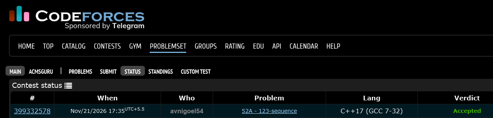

# Codeforces 52 A. **123-sequence**

## **Approach** - 
    -Counts the frequency of each number (1, 2, and 3) using three separate variables.
    -Finds the maximum frequency among the three numbers using max().
    -Prints n - max frequency, representing the minimum number of elements that need to be changed to make all elements equal.

## **Code** -
    
```cpp


#include <bits/stdc++.h>
using namespace std;

  int main() {
      int n; cin >> n;
      int one=0,two=0,three=0;
      for(int i=0;i<n;i++){
          int x; cin>>x;
          if(x==1) one++;
          else if(x==2) two++;
          else three++;
      }
      cout<<n-max({one,two,three});
  }


```


