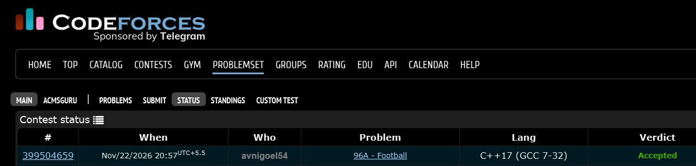

# Codeforces 96 A. **Football**

## **Approach** - 
    -Use find() to check for seven consecutive 0s or seven consecutive 1s.
    -If either substring exists, print YES; otherwise, print NO.

## **Code** -
    
```cpp

#include <bits/stdc++.h>
using namespace std;

  int main() {
  	string s; cin>>s;
  	if(s.find("0000000")!=string::npos or s.find("1111111")!= string::npos) cout<<"YES";
  	else cout<<"NO";
  }

```


