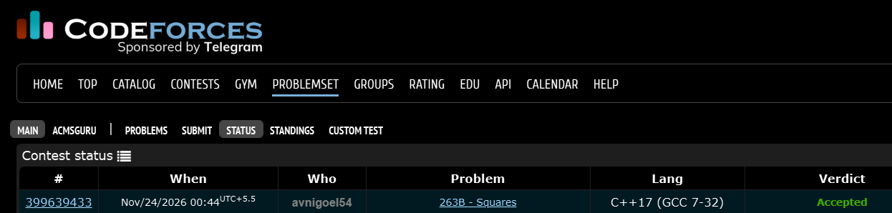

# Codeforces 263 B. **Squares**

## **Approach** - 
    -Sort the square side lengths in descending order.
    -Choose the k-th largest side length as both x and y.
    -Print (x, x) as the point belonging to exactly k squares, or -1 if k > n.

## **Code** -
    
```cpp

#include <bits/stdc++.h>
using namespace std;

  int main() {
      int n,k; cin>>n>>k;
      vector<int> a(n);
      for(int i=0;i<n;i++)cin>>a[i];
      sort(a.begin(),a.end(),greater<int>());
      if(k > n) {
          cout << -1;
          return 0;
      }
      cout<<a[k-1]<<" "<<a[k-1];
  }

```


