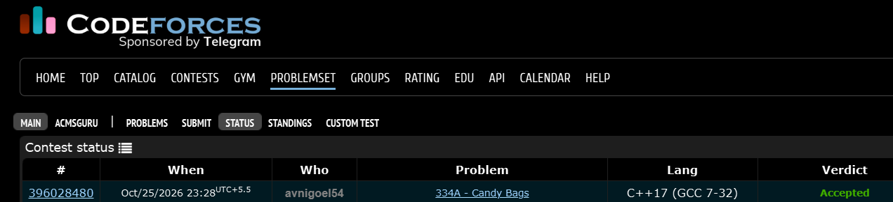

# Codeforces 334 A. **Candy Bags**

## **Approach** - 
    -Initialize l = 1 and r = n*n to track the smallest and largest unused numbers.
    -Print pairs (l, r) in each row, incrementing l and decrementing r.
    -Repeat for n rows to form the grid with equal row sums.

## **Code** -
    
```cpp

#include <bits/stdc++.h>
using namespace std;

  int main() {
  	int n; cin>>n;
  	int l=1,r=n*n;
  	for(int i=0;i<n;i++){
  	    for(int j=0; j<n/2; j++){
      	    cout<<l<<" "<<r<<" ";
      	    l++; r--;
  	    }
  	    cout<<endl;
  	}
  
  }


```


