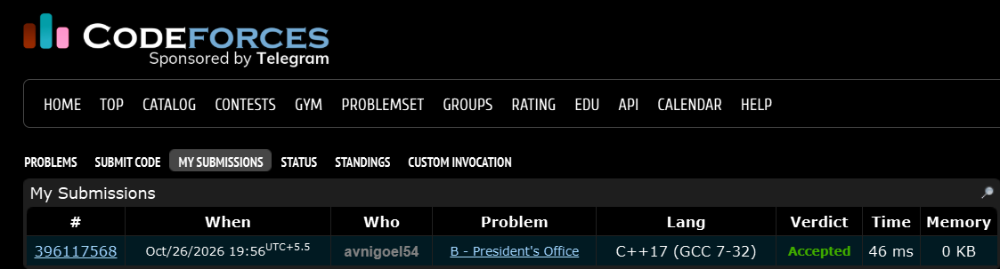

# Codeforces 6 B. **President's Office**

## **Approach** - 
    -Find the bounding rectangle containing all cells of color c.
    -Check the four sides of the rectangle and collect adjacent non-empty, different colors in a set.
    -Print the set size to count distinct neighboring colors.

## **Code** -
    
```cpp

#include <bits/stdc++.h>
using namespace std;

  int main() {
  	int n,m; cin>>n>>m;
  	char c; cin>>c;
  	char a[n][m];
  	bool abc=false;
  	int l=0,r=0,l1=0,r1=0;
  	for(int i=0;i<n;i++){
  	    for(int j=0; j<m; j++){
      	    cin>>a[i][j];
      	    if(!abc && a[i][j]==c){
      	        l=i; r=j; abc=true;
      	    }
      	    if(a[i][j]==c) {
      	        l1=i; r1=j;
      	    }
  	    }
  	}
  	set<char> st;
  	for(int i=r;i<=r1;i++){
  	    if(l>0 && a[l-1][i]!='.' && a[l-1][i]!=c) st.insert(a[l-1][i]);
  	}
  	for(int i=r;i<=r1;i++){
  	    if(l1<n-1 && a[l1+1][i]!='.' && a[l1+1][i]!=c) st.insert(a[l1+1][i]);
  	}
  	for(int i=l;i<=l1;i++){
  	    if(r>0 && a[i][r-1]!='.' && a[i][r-1]!=c) st.insert(a[i][r-1]);
  	}
  	for(int i=l;i<=l1;i++){
  	    if(r1<m-1 && a[i][r1+1]!='.' && a[i][r1+1]!=c) st.insert(a[i][r1+1]);
  	}
  	cout<<st.size();
  }


```


