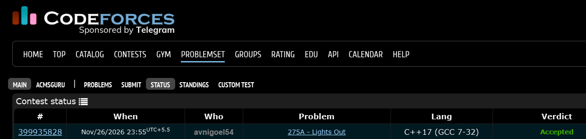

# Codeforces 275 A. **Lights Out**

## **Approach** - 
    -Use direction arrays to check each cell and its four adjacent neighbours (up, down, left, right).
    -Calculate their sum and set the corresponding output cell to 1 if the sum is even, otherwise 0.
    -Store results in a separate matrix and print the final 3×3 grid.

## **Code** -
    
```cpp


#include <bits/stdc++.h>
using namespace std;

int main() {
    int a[3][3];
    
    for(int i = 0; i < 3; i++) {
        for(int j = 0; j < 3; j++) {
            cin >> a[i][j];
        }
    }

    int dx[] = {-1, 1, 0, 0, 0};
    int dy[] = {0, 0, -1, 1, 0};

    int ans[3][3];

    for(int i = 0; i < 3; i++) {
        for(int j = 0; j < 3; j++) {
            int sum = 0;

            for(int k = 0; k < 5; k++) {
                int x = i + dx[k];
                int y = j + dy[k];

                if(x >= 0 && x < 3 && y >= 0 && y < 3) {
                    sum += a[x][y];
                }
            }

            ans[i][j] = (sum % 2 == 0) ? 1 : 0;
        }
    }

    for(int i = 0; i < 3; i++) {
        for(int j = 0; j < 3; j++) {
            cout << ans[i][j];
        }
        cout << endl;
    }

    return 0;
}


```


