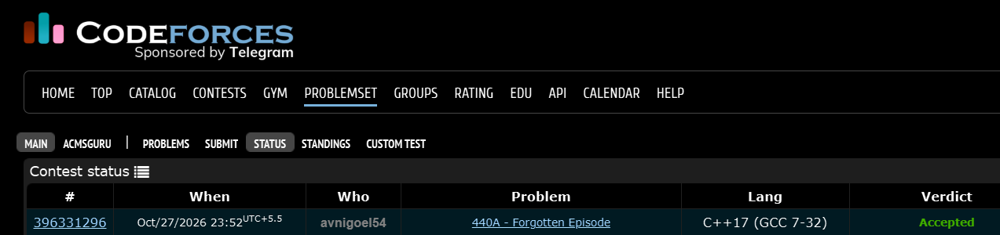

# Codeforces 440 A. **Forgotten Episode**

## **Approach** - 
    - XOR all numbers from 1 to n, then XOR the n-1 given numbers.
    -Since equal numbers cancel out under XOR (x ^ x = 0), only the missing number remains.
    -Print ans as the missing number.

## **Code** -
    
```cpp

#include <bits/stdc++.h>
using namespace std;

  int main() {
      int n;
      cin >> n;
  
      int ans = 0;
      for (int i = 1; i <= n; i++) ans ^= i;
  
      for (int i = 0; i < n - 1; i++) {
          int x;  cin >> x;
          ans ^= x;
      }
      cout << ans;
  }

```


