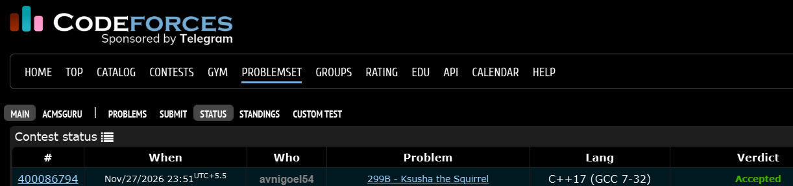

# Codeforces 299 B. **Ksusha the Squirrel**

## **Approach** - 
    -Start from the first sector and search for the farthest reachable safe sector (.) within k steps.
    -Update the current position whenever a safe sector is found.
    -Print YES if the last sector is reachable; otherwise, print NO.

## **Code** -
    
```cpp


#include <bits/stdc++.h>
using namespace std;

  int main() {
      int n, k; cin >> n >> k;
  
      string s; cin >> s;
  
      int i = 0;
      while (i < n - 1) {
          int j = i + 1;
          bool found = false;
  
          while (j < n && j <= i + k) {
              if (s[j] == '.') {
                  i = j;
                  found = true;
              }
              j++;
          }
  
          if (!found) {
              cout << "NO";
              return 0;
          }
      }
  
      cout << "YES";
      return 0;
  }


```


