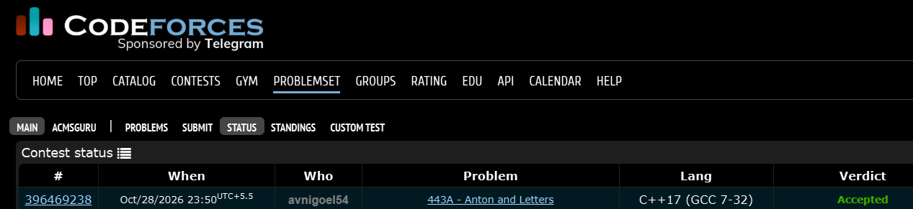

# Codeforces 443 A. **Anton and Letters**

## **Approach** - 
    -Iterate through the string and consider only lowercase English letters.
    -Store them in a set to keep only distinct characters.
    -Print the set size to get the number of distinct letters.

## **Code** -
    
```cpp

#include <bits/stdc++.h>
using namespace std;

  int main() {
      string s;
      getline(cin,s);
      set<char> st;
      for(char c: s){
          if(c>='a' && c<='z') st.insert(c);
      }
      cout<<st.size();
  }


```


