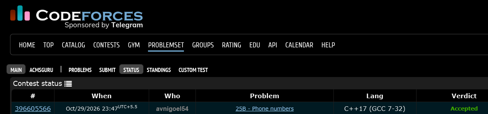

# Codeforces 25 B. **Phone numbers**

## **Approach** - 
    -If n is odd, print the first 3 digits together, then group the remaining digits in pairs.
    -If n is even, group all digits into pairs
    -Separate groups with - to format the phone number correctly.

## **Code** -
    
```cpp

#include <bits/stdc++.h>
using namespace std;

  int main() {
      int n; cin>>n;
      string s; cin>>s;
      if(n%2){
          cout<<s.substr(0,3);
          for(int i=3;i<n;i+=2){
              cout<<'-'<<s.substr(i,2);
          }
      }
      else{
          for(int i=0;i<n;i+=2){
              cout<<s.substr(i,2);
              if(i!=n-2) cout<<'-';
          }
      }
  }


```


