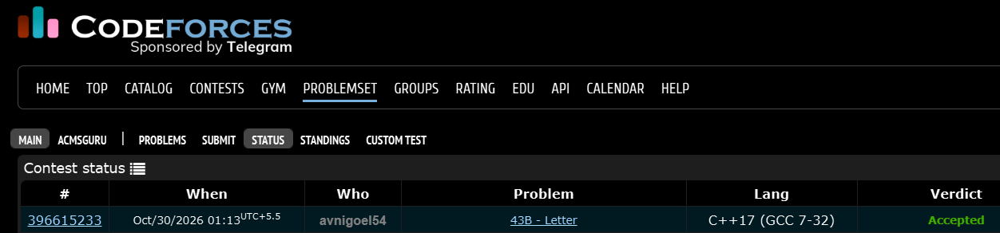

# Codeforces 43 B. **Letter**

## **Approach** - 
    -Count the frequency of each non-whitespace character in both strings using maps.
    -While processing the second string, check if any character's required frequency exceeds its availability in the first string.
    -Print YES if all characters are available in sufficient quantities; otherwise, print NO.

## **Code** -
    
```cpp

#include <bits/stdc++.h>
using namespace std;

  int main() {
      string s1,s2;
      getline(cin,s1);
      getline(cin,s2);
      map<char,int> mp1;
      map<char,int> mp2;
      for(char c:s1){
          if(!isspace(c)) mp1[c]++;
      }
      bool abc=true;
      for(char c:s2){
          if(!isspace(c)){
              mp2[c]++;
              if(mp1[c]<mp2[c]) abc=false;
          }
      }
      abc ? cout<<"YES" : cout<<"NO";
  }

```


