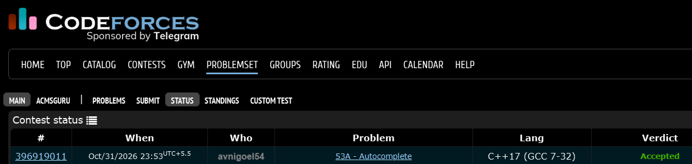

# Codeforces 53 A. **Autocomplete**

## **Approach** - 
    -Iterate through all n strings and filter those starting with the given prefix s.
    -Keep the lexicographically smallest matching string.
    -Print the smallest match, or s if no match exists.

## **Code** -
    
```cpp

#include <bits/stdc++.h>
using namespace std;

  int main() {
      string s; cin>>s;
      int n; cin>>n;
      string mn="";
      int cnt=0;
      while(cnt<n){
          string a; cin>>a;
          if(a.substr(0,s.size())==s){
              if(mn=="")mn=a;
              else if(a < mn) mn = a;
          }
          cnt++;
      }
      if(mn!="")cout<<mn;
      else cout<<s;
  }

```


